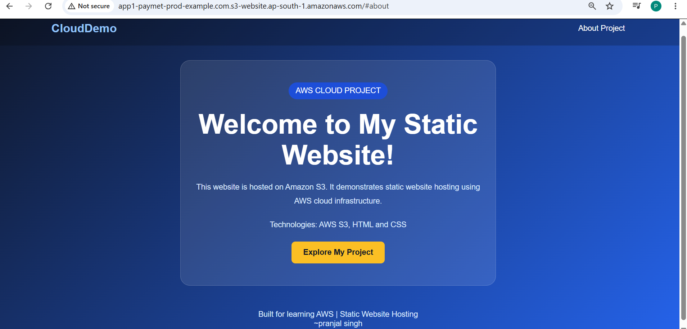

# AWS S3 Static Website Hosting

## Project Overview
This project demonstrates how to host a static website using Amazon S3.

## AWS Services Used
- Amazon S3
- S3 Static Website Hosting
- S3 Bucket Policy
- AWS Management Console

## Implementation Steps
1. Created an S3 bucket.
2. Uploaded the `index.html` file.
3. Enabled static website hosting.
4. Configured bucket permissions using a JSON bucket policy.
5. Configured public access settings as required for the website.
6. Verified that the website was running successfully.
7. Captured screenshots as proof of deployment.

## Project Screenshot
See the `screenshots` folder for the deployed website screenshot.

## Files
- `index.html` — Website source code.
- `bucket-policy.json` — Example S3 bucket policy.
- `screenshots/` — Website deployment evidence.

## Learning Outcomes
- Learned basic Amazon S3 configuration.
- Practiced static website hosting.
- Learned about S3 bucket policies and public access settings.
- Understood the relationship between website hosting and bucket permissions.

## Security Note
The bucket policy and public access configuration must be reviewed carefully before deployment. Never upload AWS credentials or other secrets.
## Website Screenshots

